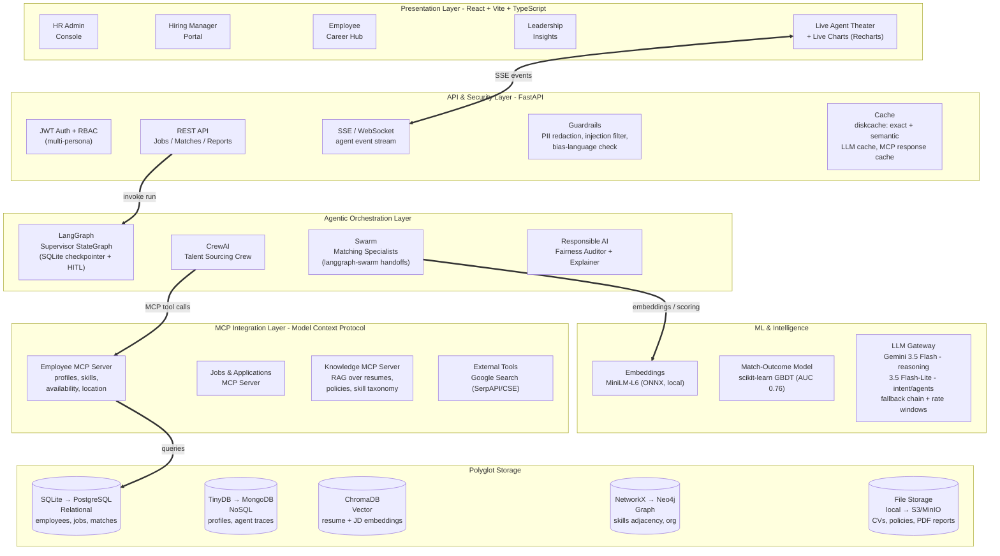
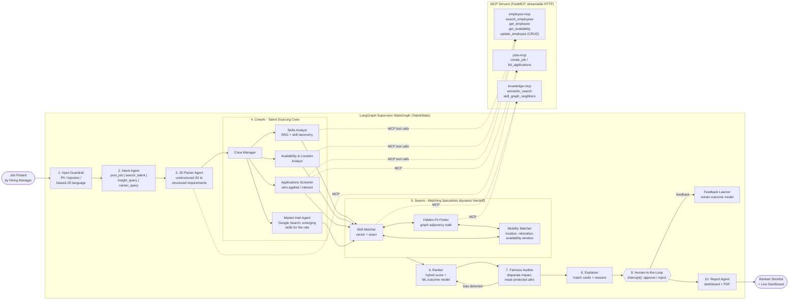
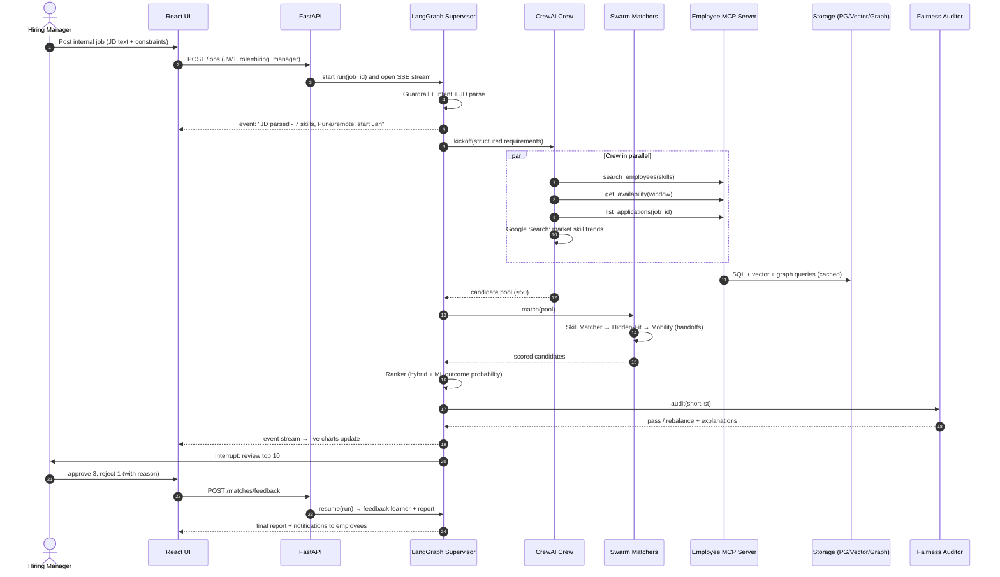
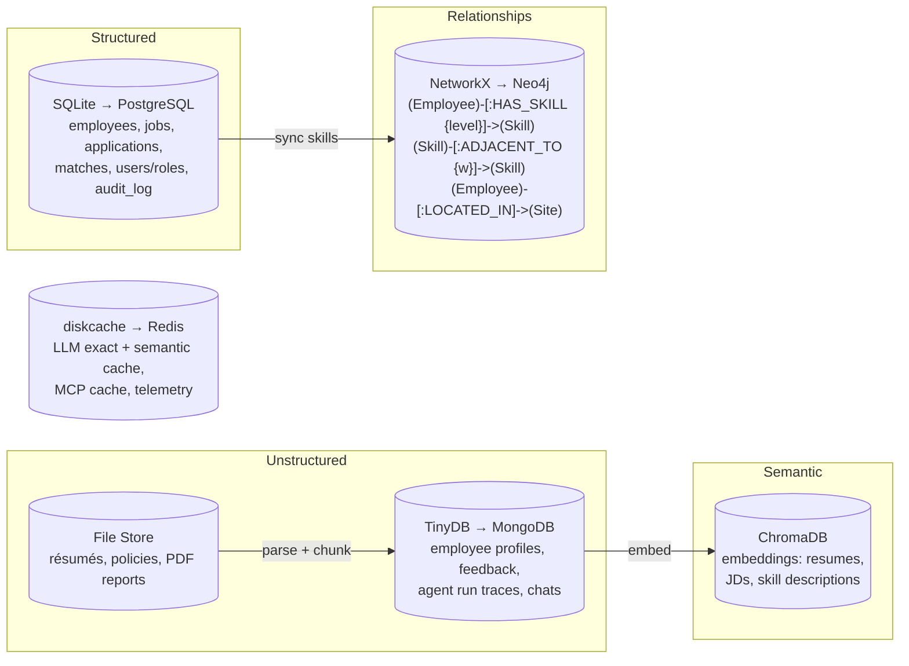

# TalentFlow AI — Internal Talent Marketplace
### Solution Architecture & Agentic Framework (v1.0 — as built)

> **One line:** When a job is posted, a team of AI agents (LangGraph + CrewAI + Swarm) pulls employee data over **MCP**, finds and ranks the best internal candidates by **skills, applications, location and availability**, checks the results for bias, and shows explainable shortlists on a live React dashboard.

---

## 1. Business problem & impact

| Pain today | TalentFlow AI outcome | KPI shown on dashboard |
|---|---|---|
| Internal roles filled externally (costly, slow) | Proactive internal shortlist within minutes of posting | Time-to-shortlist, % internal fill |
| Hidden talent: skills not in job titles | Skill-adjacency graph + embeddings surface "hidden-fit" employees | Hidden-fit candidates found |
| Attrition from lack of mobility | Employees see matched roles and upskilling paths | Mobility rate, retention-risk drop |
| Biased / opaque shortlisting | Fairness auditor + explainable match cards | Disparate-impact ratio, audit log |

**Novelty**
1. **Live Agent Theater**: the UI streams each agent's thinking, tool calls and handoffs in real time (SSE).
2. **Three agent styles in one pipeline**: LangGraph controls the flow, a CrewAI crew does the analysis, and a Swarm of matchers hands work to each other as needed.
3. **Hidden-fit discovery**: a graph walk over skill adjacency (Neo4j) finds employees who are one upskilling step away from the role.
4. **Fairness auditor in the loop**: protected attributes are masked during matching, and a disparate-impact check runs before the shortlist is shown.
5. **Human-in-the-loop**: LangGraph `interrupt()` lets the hiring manager approve or reject; that feedback retrains the ML outcome model.

---

## 2. Solution architecture (logical)



---

## 3. Agentic framework (how the agents work together)



**Why each framework is used where it is**

| Framework | Role | Why it fits |
|---|---|---|
| **LangGraph** | Main workflow: state, retries, checkpointing, conditional edges, human-in-the-loop `interrupt()` | Predictable flow that can be audited and resumed |
| **CrewAI** | Role-based analysis crew that works in parallel | Natural "team of analysts" setup, each role with its own tools |
| **Swarm** (`langgraph-swarm`) | Matching specialists that hand work to each other as needed | Matching is exploratory; each specialist decides who should go next |
| **MCP** | The only way agents can read or change employee and job data | One standard interface that can be swapped and governed; the same servers work with Claude Desktop or IDEs |

---

## 4. End-to-end sequence: "Job posted to shortlist"



---

## 5. Hybrid match score (explainable)

```
match_score = 0.35 * skill_fit        (exact + semantic similarity, weighted by proficiency)
            + 0.15 * adjacency_bonus  (graph distance to missing skills — "hidden fit")
            + 0.15 * availability_fit (overlap of availability window with job start)
            + 0.10 * location_fit     (same site / remote / relocation willingness)
            + 0.10 * application_signal (applied / bookmarked / career-interest match)
            + 0.15 * P(success)       (ML outcome model trained on past placements)
```
Hard filters (guardrails): minimum tenure in current role, manager-release policy, active performance plan. Every candidate card shows the breakdown of each component.

---

## 6. Data & storage coverage



> **As built (no Docker on the demo machine):** each store is an embedded engine behind its own storage module (`backend/app/storage/`): SQLite, TinyDB, ChromaDB, NetworkX (Neo4j-compatible labels), local file system, and diskcache for caching. Swapping in PostgreSQL, MongoDB, Neo4j, S3 or Redis changes one module each; agents and MCP tools are unaffected.

---

## 7. Personas (multi-persona login)

| Persona | Sees / does |
|---|---|
| **HR Admin** | Manage employees through MCP CRUD, guardrail and fairness settings, audit log, agent traces |
| **Hiring Manager** | Post jobs, watch the Live Agent Theater, review explainable shortlists, approve or reject |
| **Employee** | Own profile, matched roles ("why you fit"), skill-gap and upskilling path, apply |
| **Leadership** | Mobility trends, skill-supply heatmap, internal-fill rate, cost avoided |

---

## 8. Governance, Responsible AI & guardrails

- **Input guardrails:** PII redaction (Presidio-style regex/NER), prompt-injection detection, and a check for exclusionary job-description wording ("young", "native speaker", …).
- **Output guardrails:** Pydantic schema validation on every agent output, JSON repair, grounding check (each claimed skill must exist in the MCP data).
- **Fairness:** protected attributes (gender, age, ethnicity) are never sent to the LLM; a disparate-impact ratio (four-fifths rule) is checked on the shortlist.
- **Explainability:** a score breakdown and evidence quotes for every match.
- **Caching:** exact LLM response cache (72 h), semantic cache for Copilot answers (cosine ≥ 0.95), MCP tool-response cache with TTL, and cached Google Search results.
- **Auditability:** every agent step, tool call and handoff is saved in MongoDB and can be replayed in the UI.
- **RBAC on MCP tools:** employees can only read their own records; HR can do full CRUD.

---

## 9. Technology stack

| Layer | Choice |
|---|---|
| Frontend | React 19 + Vite 8 + TypeScript, Tailwind 4, Recharts, React Query, lucide icons |
| Theme | Formal: Navy `#0B1F3A`, Slate `#334155`, Steel blue `#2F6690`, Gold accent `#C9A227`, White/Ivory |
| Backend | Python 3.11, FastAPI, Pydantic v2, SSE |
| Agents | LangGraph, langgraph-swarm, CrewAI, langchain-mcp-adapters |
| MCP | `mcp` Python SDK (FastMCP), streamable HTTP transport |
| LLM | Gemini 3.5 Flash (reasoning), 3.5 Flash-Lite (intent and agents), with a fallback chain across 4 models, per-model rate windows (free tier: 5 requests/minute) and a deterministic fallback for every stage |
| ML | all-MiniLM-L6-v2 on ONNX Runtime (local, 384 dimensions); scikit-learn HistGradientBoosting outcome model with a model card and permutation importance |
| Storage | SQLite, TinyDB, ChromaDB, NetworkX (persisted), local FS, diskcache — each replaceable with PostgreSQL, MongoDB, Neo4j, S3 or Redis |
| DevOps | `start.ps1` launcher, MCP supervisor with auto-restart, pytest, oxlint, `tsc -b` |

---

## 10. Repository layout (as built)

```
ai-friday-tryout/
├── docs/                       architecture (md + html), agile/, presentation
├── backend/
│   ├── app/
│   │   ├── agents/             graph.py (LangGraph) · crew.py (CrewAI) · swarm.py (langgraph-swarm)
│   │   │                       nodes/front.py · nodes/back.py · scoring.py · sourcing_tools.py · events.py · intent.py
│   │   ├── api/                routes.py (REST + SSE) · deps.py (JWT, RBAC)
│   │   ├── core/               config.py · llm.py (Gemini gateway)
│   │   ├── guardrails/         checks.py (PII, injection, inclusive language, grounding)
│   │   ├── ml/                 embeddings.py · outcome_model.py
│   │   ├── services/           career.py · assistant.py · insights.py
│   │   ├── storage/            relational · document · vector · graph · files · cache
│   │   ├── mcp_client.py       MCP client with role headers and telemetry
│   │   └── reports.py          PDF shortlist report
│   ├── mcp_servers/            employee_server.py (:8101) · jobs_server.py (:8102) · knowledge_server.py (:8103)
│   ├── scripts/                bootstrap.py · run_mcp_servers.py
│   └── tests/                  guardrails · scoring · intent+ML · API
├── data/                       taxonomy.py · generate_seed.py · seed/*.json · files/resumes · files/policies
├── frontend/src/               pages/ (persona workspaces) · components/ (AgentTheater, MatchCard, charts, Copilot) · lib/
└── start.ps1
```

---

## 11. Rubric coverage map

| Rubric item | Where it is covered |
|---|---|
| Fully agentic AI framework | LangGraph supervisor + CrewAI crew + Swarm (§3) |
| RAG, intent identification, multi-agent | Knowledge MCP RAG, Intent Agent, 12+ agents |
| Caching, responsible AI, guardrails | Exact + semantic cache, fairness auditor, input/output guardrails (§8) |
| MCP enablement | 3 FastMCP servers; employee data available **only** through MCP |
| Tool calling (Google Search, DB CRUD) | Market Intel agent (Google Search); employee-mcp CRUD tools |
| Structured + unstructured data | PostgreSQL rows + resume PDFs/JD text parsed into JSON |
| Reports, dashboards, graphs, trends | Live Agent Theater, live charts, Leadership trends, PDF report |
| ML outcome embeddings | Embedding-based matching + success-probability model with feedback loop |
| Storage: relational, NoSQL, vector, graph, file | SQLite, TinyDB, ChromaDB, NetworkX graph, file store (§6) |
| React UI, multi-persona, best practices | React+TS, 4 personas, RBAC, typed APIs, tests, lint |
| Agile documentation, presentation | `docs/agile/` epics, stories, sprint board, and slide deck |
| Architecture, business impact, novelty | This document (§1–§3) |
